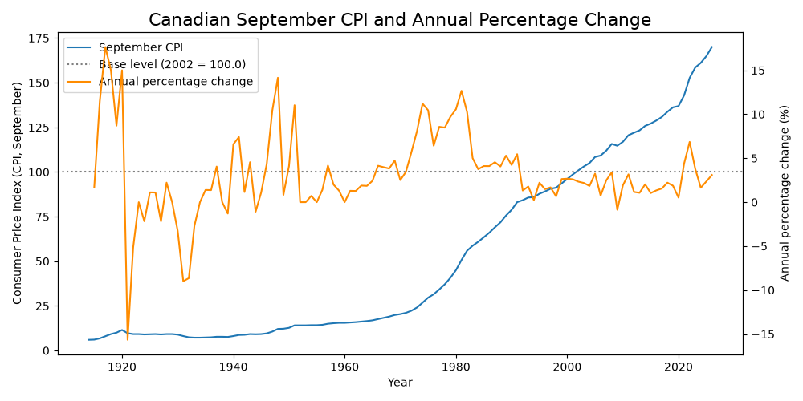
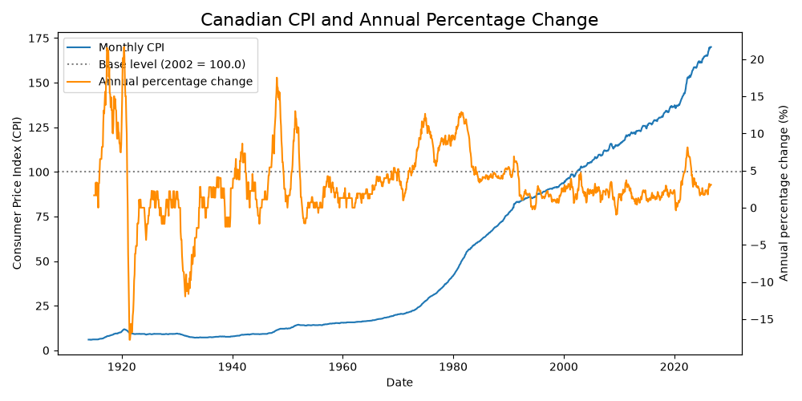

# Bank of Canada Inflation Calculator

## Project overview

This project recreates the The Bank of Canada's [Inflation Calculator](https://www.bankofcanada.ca/rates/related/inflation-calculator/) and enhances it to use monthly dates. Both versions use the Bank of Canada monthly all-items Consumer Price Index (CPI) data.

- **Original calculator:** asks for a dollar amount and two years, then uses each year's September CPI value.
- **Enhanced calculator:** asks for a dollar amount and two month/year periods in `MM/YYYY` format, then uses CPI for the exact months entered. It validates the amount and dates.

Both programs adjust the cost of a basket using the ratio of the CPI values. Pandas reads and organizes the data, NumPy calculates the compound average annual rate, and Matplotlib creates the CPI graphs.

## Project files

| File | Description |
|---|---|
| `Bank_Of_Canada_CPI_Calculator_Original.py` | Year-based calculator using September CPI. |
| `Bank_Of_Canada_CPI_Calculator_Enhanced.py` | Monthly calculator with `MM/YYYY` input and validation. |
| `STATIC_INFLATIONCALC.csv` | Monthly CPI observations used by both programs. |
| `original_cpi_graph_september.png` | Graph for the original calculator. |
| `enhanced_cpi_graph.png` | Graph for the enhanced calculator. |
| `README.md` | Project overview, instructions, code walkthroughs, graphs, and sample output. |

## Instructions

Keep the CSV file in the same folder as both Python scripts. 
Keep the two generated graph images (`original_cpi_graph_september.png` & `enhanced_cpi_graph.png`) beside this README so GitHub can display them.

Install Python 3 and the required packages:

```bash
python -m pip install numpy pandas matplotlib
```

Run either calculator from the project folder:

```bash
python Bank_Of_Canada_CPI_Calculator_Original.py
python Bank_Of_Canada_CPI_Calculator_Enhanced.py
```

The original program has 3 inputs, it asks for a dollar amount and two years. Commas and spaces in the amount are allowed and it assumes the amount and years are valid. The enhanced program also has 3 inputs, and asks for a positive amount and two dates in `MM/YYYY` format, such as `09/1915`. It repeats the prompt if the amount or date is invalid, outside the data range, or for a month without a CPI observation. Each program saves its graph as `inflation_cpi_chart.png` in the working folder. Running the other version in the same folder replaces that generated graph.

# Original calculator: September CPI by year

Similarly to the calculator avilable on the Bank of Canada website, the original program only accepts calendar years. It filters the monthly CPI data to September observations, so the selected CPI for 1915, for example, is the September 1915 observation. It then applies the CPI ratio to estimate the equivalent basket cost in the second year.

## Original code walkthrough

### 1. Imports

The program imports NumPy, Pandas, and Matplotlib.

```python
import numpy as np
import pandas as pd
import matplotlib.pyplot as plt
```

NumPy is used for exponentiation in the annualized inflation calculation. Pandas reads and filters the CSV data. Matplotlib builds and saves the graph.

### 2. Read and prepare the CSV data

The CSV begins with eight rows of file information before the observations. `skiprows=8` skips those rows. The next lines keep the date and CPI columns, rename them, and convert them to date and numeric values so the program can filter and calculate with them.

```python
df = pd.read_csv("STATIC_INFLATIONCALC.csv", skiprows=8)
df = df[["date", "STATIC_INFLATIONCALC"]]
df = df.rename(columns={"date": "Date", "STATIC_INFLATIONCALC": "CPI"})
df["Date"] = pd.to_datetime(df["Date"])
df["CPI"] = pd.to_numeric(df["CPI"])
```

### 3. Select one CPI value per year

The code extracts a year and month from every date. It keeps only rows where the month is `9`, which is September, and groups those rows by year. Because there is one September observation per year, the series contains September CPI for each year.

```python
df["Year"] = df["Date"].dt.year
df["Month"] = df["Date"].dt.month
september_cpi = df[df["Month"] == 9]
annual_cpi = september_cpi.groupby("Year")["CPI"].mean()
```

The original graph's annual percentage change compares September CPI with the preceding year's September CPI:

```python
annual_change = annual_cpi.pct_change() * 100
```

### 4. Collect the user's inputs and look up CPI

The user enters an amount and two years. The program removes commas and spaces before converting the amount to a number. It uses the latest September year available in the CSV in the prompts. `.loc` retrieves the September CPI for each selected year.

```python
amount = input("Enter a dollar amount (commas and spaces may be used): $")
amount = float(amount.replace(",", "").replace(" ", ""))

latest_year = annual_cpi.index.max()
first_year = int(input("Enter the first year (1914 to {}): ".format(latest_year)))
second_year = int(input("Enter the second year (1914 to {}): ".format(latest_year)))

cpi1 = annual_cpi.loc[first_year]
cpi2 = annual_cpi.loc[second_year]
```

The original version expects valid inputs. For example, the entered years should exist in the CPI series, and the amount should be numeric and greater than zero.

### 5. Calculate the adjusted cost and inflation results

The cost formula multiplies the original amount by the ratio of the second CPI to the first CPI. The percentage formula compares the adjusted cost with the original amount. The program uses the absolute year difference for the time period. The average annual rate is a compound rate. When both selected years are equal, it sets the rate to 0.00%.

```python
adjusted_cost = amount * (cpi2 / cpi1)
percentage_change = ((adjusted_cost - amount) / amount) * 100
number_of_years = abs(second_year - first_year)

if number_of_years == 0:
    average_annual_rate = 0.0
else:
    average_annual_rate = (np.power(cpi2 / cpi1, 1 / number_of_years) - 1) * 100
```

The program prints the amount and adjusted amount to two decimal places, adds `CAD` to identify the currency, and prints the percentage, period, annualized rate, and CPI values.

### 6. Create and save the original graph

The original graph plots the September CPI series on the left axis. `axhline` adds the dotted CPI = 100.0 reference line. `twinx()` creates a right axis for annual percentage change, which is measured in percent rather than CPI index points. The code combines the three plotted lines in one legend, adjusts the spacing, saves the graph, and displays it.

```python
fig, ax1 = plt.subplots(figsize=(10, 5))
cpi_line, = ax1.plot(annual_cpi.index, annual_cpi.values, label="September CPI")
base_line = ax1.axhline(y=100.0, color="gray", linestyle=":",
                        label="Base level (2002 = 100.0)")
ax2 = ax1.twinx()
change_line, = ax2.plot(annual_change.index, annual_change.values,
                        color="darkorange", label="Annual percentage change")
```

### Original CPI graph

The left axis shows September CPI. The right axis shows the percentage change from one September to the next. The dotted line marks the 2002 reference level of 100.0.



# Enhanced calculator: monthly CPI and date validation

The enhanced calculator accepts month and year, so the user can compare specific monthly CPI observations instead of being limited to September. It repeats the amount or date prompt until the input is valid and the selected month exists in the CSV.

## Enhanced code walkthrough

### 1. Imports & input functions

The enhanced program uses the same three libraries as the original. It defines two functions before the main program:

- `get_amount()` asks for a positive numeric amount. It removes $, commas, and spaces, converts the text to a number, and catches `ValueError` if the text cannot be converted.
- `get_period()` asks for a month and year, then checks the format, the available date range, and whether the CPI series contains that exact month.


```python
def get_amount():
    while True:
        amount_text = input("Enter the price of the goods or services: $")
        amount_text = amount_text.replace("$", "").replace(",", "").replace(" ", "")
        try:
            amount = float(amount_text)
            if amount > 0:
                return amount
            else:
                print("Please enter an amount greater than zero.")
        except ValueError:
            print("Please enter a valid number, such as 100000 or 100,000.00.")
```

### 2. Validate and convert the entered periods

`get_period()` receives the prompt text and the monthly CPI series. It uses the earliest and latest dates in the data to set the allowed range. `pd.to_datetime()` converts `MM/YYYY` into a date; `errors="coerce"` returns `NaT` for an invalid entry. The following checks reject invalid formatting, dates outside the available range, and months without an observation.

```python
period = pd.to_datetime(date_text, format="%m/%Y", errors="coerce")

if pd.isna(period):
    print("Please enter a valid month and year in MM/YYYY format.")
elif period < first_date or period > last_date:
    print("Enter a date between {} and {}.".format(
        first_date.strftime("%m/%Y"), last_date.strftime("%m/%Y")
    ))
elif period not in monthly_cpi.index:
    print("There is no CPI value for that month in the data.")
else:
    return period
```

### 3. Read and prepare monthly CPI data

The enhanced version reads the same CSV and keeps the same two columns as the original. It converts the date and CPI columns, makes dates the index, and sorts the CPI series chronologically. The date index makes it possible to look up CPI by an exact month.

```python
df = pd.read_csv("STATIC_INFLATIONCALC.csv", skiprows=8)
df = df[["date", "STATIC_INFLATIONCALC"]]
df = df.rename(columns={"date": "Date", "STATIC_INFLATIONCALC": "CPI"})
df["Date"] = pd.to_datetime(df["Date"])
df["CPI"] = pd.to_numeric(df["CPI"])
df = df.set_index("Date")
monthly_cpi = df["CPI"].sort_index()
```

### 4. Get the input periods and select their CPI values

The program calls `get_amount()` and calls `get_period()` once for each comparison period. It then uses the selected dates to retrieve CPI values from the monthly series.

```python
amount = get_amount()
first_period = get_period("Enter the first period (MM/YYYY): ", monthly_cpi)
second_period = get_period("Enter the second period (MM/YYYY): ", monthly_cpi)

cpi1 = monthly_cpi.loc[first_period]
cpi2 = monthly_cpi.loc[second_period]
```

### 5. Calculate the adjusted cost and inflation results

The adjusted-cost and total percentage-change calculations are the same as in the original version. The enhanced version calculates elapsed time in months using the year and month parts of each date, then converts months to years for the annualized rate.

```python
adjusted_cost = amount * (cpi2 / cpi1)
percentage_change = ((adjusted_cost - amount) / amount) * 100

month_difference = (second_period.year - first_period.year) * 12
month_difference = month_difference + second_period.month - first_period.month
number_of_years = abs(month_difference) / 12
```

If the selected periods are identical, the annual rate is 0.00%. Otherwise, NumPy raises the CPI ratio to the reciprocal of the number of years, computing a compound annual rate. The results are printed in the Bank of Canada layout, with dates displayed as month and year and prices identified as CAD.

### 6. Create and save the enhanced graph

The enhanced graph plots every monthly CPI value. `pct_change(periods=12)` compares each month with the same month one year earlier. It returns a proportion, so the code multiplies it by 100 to get a percentage. The graph puts CPI on the left axis and the year-over-year percentage on the right, adds the dotted base line and legend, then saves and displays the figure.

```python
annual_change = monthly_cpi.pct_change(periods=12) * 100
fig, ax1 = plt.subplots(figsize=(10, 5))
cpi_line, = ax1.plot(monthly_cpi.index, monthly_cpi.values, label="Monthly CPI")
base_line = ax1.axhline(y=100.0, color="gray", linestyle=":",
                        label="Base level (2002 = 100.0)")
ax2 = ax1.twinx()
change_line, = ax2.plot(annual_change.index, annual_change.values,
                        color="darkorange", label="Annual percentage change")
```

The enhanced annual percentage-change line begins after 12 months because the program needs a previous-year CPI value for comparison.

### Enhanced CPI graph

The left axis shows monthly CPI. The right axis shows the year-over-year percentage change. The dotted line marks the 2002 CPI reference level of 100.0.




## Formulas and calculations

Let `Cost1` be the price in the first period, `CPI1` the CPI in that period, `Cost2` the price in the target period, and `CPI2` the CPI in the second period.

**Adjusted cost in the second period**

```text
Cost2 = Cost1 × (CPI2 / CPI1)
```

**Total percentage change**

```text
Percent change = ((Cost2 - Cost1) / Cost1) × 100
```

**Elapsed time**

For the original calculator:

```text
Number of years = absolute value of (Year2 - Year1)
```

For the enhanced calculator:

```text
Months between periods = (Year2 - Year1) × 12 + (Month2 - Month1)
Number of years = absolute value of months between periods / 12
```

**Average annual rate of inflation**

```text
Average annual rate = ((CPI2 / CPI1)^(1 / number of years) - 1) × 100
```

If both selected periods are identical, the program returns 0.00% because there is no elapsed time to annualize.

**Annual percentage change in the graphs**

The original graph compares September CPI with September CPI from the previous year. The enhanced graph compares each month's CPI with CPI from 12 months earlier.

```text
Annual percentage change = ((CPI in this period / CPI in the same period one year earlier) - 1) × 100
```

## What is CPI?

The Consumer Price Index measures changes over time in the prices consumers pay for a representative basket of goods and services. The basket attempts to reflect household spending, and the components that make it up have weights based on their relative importance. CPI is a broad measure and a person's personal inflation can differ depending on their spending.

The CPI index reference period is 2002 = 100.0. A CPI value of 136.9 means the index level is 36.9% above its 2002 reference level. A simplified fixed-basket explanation is:

```text
CPI in a period = (Cost of the representative basket in that period / Cost of the basket in the base period) × 100
```

Statistics Canada calculates CPI using a detailed weighted index methodology and updates basket weights over time. Further information and details are available at [Statistics Canada's CPI FAQ](https://www.statcan.gc.ca/en/subjects-start/prices_and_price_indexes/consumer_price_indexes/faq) and [CPI reference paper](https://www150.statcan.gc.ca/n1/en/pub/62-553-x/62-553-x2023001-eng.pdf). The Bank of Canada's [Inflation Calculator](https://www.bankofcanada.ca/rates/related/inflation-calculator/) explains how CPI is used to compare basket costs over time.


## CPI Graph Commentary


Both graphs show CPI rising over the long term, as expected. There is a sharper increase from the 1970s onwards and large increase in the early 2020s. In comparison, the annual percentage change is much more volatile. Statistics Canada reports that CPI rose 48.3% following WW1, with annual average inflation reaching 17.9% in 1917, and the subsequent 1930s dip aligning with the deflationary period of the Great Depression. Rises in the 1970s and 1980s align with oil and commodity price shocks. According to the data CPI rose from 20.4 in September 1970 to 45 in september 1980, a total increase of 120.59% and an average annual rate of 8.23%. While the sharp 2021-2022 increase correlates with pandemic supply shortages and higher commodity prices, with the Russia-Ukraine war adding inflationary pressure. From September 2019 to September 2022, CPI increased from 136.2 to 152.7, a 12.11% increase in just ~3 years. The monthly graph produced by the enhanced code makes short term changes easier to visualise. Even when annual percentage changes fall, CPI can continue to rise as prices increase at a slower rate, rather than returning to earlier levels.

## Sample output

Both examples use **CAD $100,000.00** and CPI values of 6.1 and 136.9. Amounts are rounded to the nearest cent and identify the currency as CAD.

### Original calculator

Inputs: amount `100,000.00`, first year `1915`, second year `2020`.

```text
A "basket" of goods and services
...that cost:
$100,000.00 CAD in 1915

...would cost:
$2,244,262.30 CAD in 2020

Percent change: 2,144.26%
Number of years: 105
Average annual rate of inflation (%) / Decline in the value of money: 3.01%
CPI for first year: 6.1
CPI for second year: 136.9
2002 CPI = 100.0
```

### Enhanced calculator

Inputs: amount `100,000.00`, first period `09/1915`, second period `09/2020`.

```text
A "basket" of goods and services
...that cost:
$100,000.00 CAD in September 1915

...would cost:
$2,244,262.30 CAD in September 2020

Percent change: 2,144.26%
Number of years: 105
Average annual rate of inflation (%) / Decline in the value of money: 3.01%
CPI for first period: 6.1
CPI for second period: 136.9
2002 CPI = 100.0
```

## Summary

The original calculator compares years by pulling the September CPI as the yearly CPI. The enhanced calculator lets users choose exact months and validates their inputs. Both use the CPI ratio to adjust the price and calculate the total and compound annual changes. From September 1915 to September 2020, CPI rises from 6.1 to 136.9; CAD $100,000.00 becomes CAD $2,244,262.30. That is a 2,144.26% total increase and a 3.01% compound average annual rate over 105 years.

## References

Bank of Canada. (n.d.). *Inflation Calculator* https://www.bankofcanada.ca/rates/related/inflation-calculator/

Bank of Canada. (1999). *Canadian economic performance at the end of the twentieth century* (Staff discussion paper 99-5). https://www.bankofcanada.ca/1999/06/canadian-economic-performance-end-twentieth-century/
- Historical context on the rise of oil and commodity prices in the 1970s.

Bank of Canada. (2022, October). *What’s happening to inflation and why it matters*. https://www.bankofcanada.ca/2022/10/whats-happening-to-inflation-and-why-it-matters/
- Pandemic-era supply disruptions, global energy prices and the effects of Russia’s invasion of Ukraine on commodity prices.

Bank of Canada. (2024). *Sources of pandemic-era inflation in Canada: An application of the Bernanke and Blanchard model* (Staff analytical note 2024-13). https://www.bankofcanada.ca/2024/06/staff-analytical-note-2024-13/
- Food and energy prices, and pandemic-era inflationary pressure.

Charest, J., & White, J. (2015). *Exploring the first century of Canada’s Consumer Price Index*. Statistics Canada. https://www150.statcan.gc.ca/n1/pub/62-604-x/62-604-x2015001-eng.htm
- Explains CPI, price changes during WW1 & the Great Depression.

NumPy Developers. (n.d.). *numpy.power*. NumPy documentation. https://numpy.org/doc/stable/reference/generated/numpy.power.html
- Raising value to a power, used in annual inflation calculation.